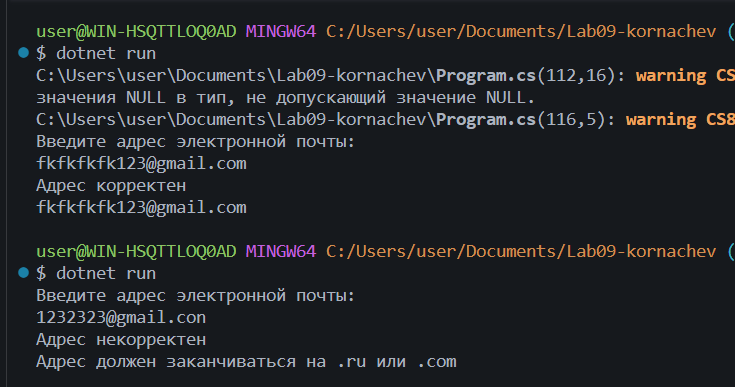
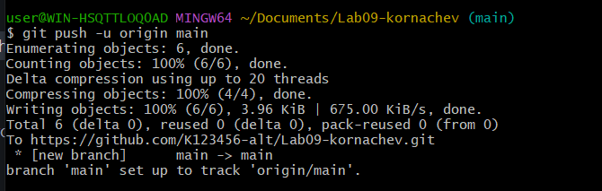

# Практическая работа №9
**Корначев Кирилл Александрович**
**Группа: ИСП-243**
**Дата: 24.10.2026**
## Что изучено
- *проверять содержимое строки (Contains, StartsWith, EndsWith);*
- *преобразовывать строки (ToUpper, ToLower, Replace, Substring);*
- *решать небольшие задачи на обработку введённого текста.*
## Скриншоты

